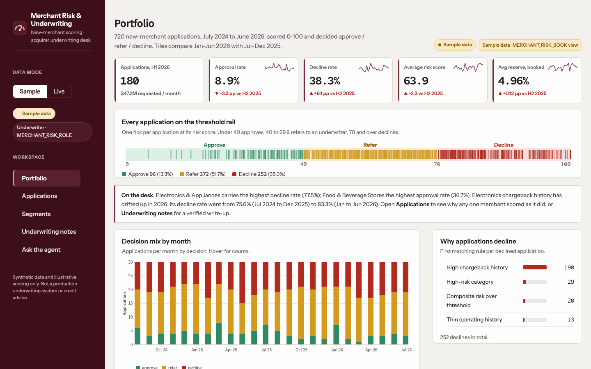

# Merchant Risk & Underwriting — a Snow Pack

Score every new-merchant application — approve, refer, or decline — with an explainable 0–100 risk view, a reserve %, and an underwriting note the model is prevented from making up, all on Snowflake.

Owner: Javier Soliz · Last reviewed: November 2026

**Guide:** https://sfc-gh-jsoliz.github.io/sfguide-merchant-risk/ · **Try it (no account):** https://sfc-gh-jsoliz.github.io/sfguide-merchant-risk/try/



## What it shows

A Streamlit app for the underwriting and risk-operations team at a payments processor or merchant acquirer. It reads a synthetic book of 720 new-merchant applications (July 2024 to June 2026) and gives the team five screens:

| Screen | What it does | Snowflake capability |
|---|---|---|
| **Portfolio** | KPI tiles with trends, every application on the 0–100 threshold rail, decision mix by month, decline reasons, and a CFPB payment-complaint backdrop joined by month | Snowpark session over the `MERCHANT_RISK_BOOK` view |
| **Applications** | A filterable, sortable review queue; select a merchant to see each factor's contribution to its score, its decision reason and reserve | `MERCHANT_RISK_SCORE_FACTORS` view |
| **Segments** | Category × credit tier heatmap, score distribution, and the change in decline rate between the first and last six months | Same views |
| **Underwriting notes** | A one-page note written only from a fact pack of allowed numbers, then fact-checked by a second pass and badged **Verified** or **Needs review** | Cortex `AI_COMPLETE` (twice), saved to `MERCHANT_RISK_REPORTS` |
| **Ask the agent** | Plain-English questions; the agent writes SQL over the semantic view and answers from the result, showing the table and SQL | Cortex Agent (`MERCHANT_RISK_AGENT`, via `DATA_AGENT_RUN`) with Cortex Analyst over `MERCHANT_RISK_SV` |

The CFPB backdrop is an external, non-additive industry signal, joined to the book **by month only**. It is not this processor's own complaints. By default it is a synthetic CFPB-style series; `sql/cfpb_live_backdrop.sql` swaps in the free CFPB Complaint Database.

## How the score works

Each application's risk score is the sum of five factors, clamped to 0–100 (the original pack's formula):

| Factor | Contribution |
|---|---|
| Category base risk | 28 (grocery) to 62 (electronics) |
| Chargeback history | + chargeback bps ÷ 10 |
| Credit tier | + 8 per step from A-Prime to D-HighRisk |
| Years trading | − 1.2 per year, capped at 15 years |
| Switching from a prior processor | − 5 |

Under 40 approves, 40 to 69.9 refers to an underwriter, and 70 or more declines with the first matching reason (high chargeback history, thin operating history, high-risk category, composite). Approved merchants carry a reserve of score ÷ 20 %, referred merchants score ÷ 10 %, declines none.

## Prerequisites

- A Snowflake account (Enterprise Edition or higher recommended) in a region where Cortex AI functions and Cortex Agents are available, with access to `claude-sonnet-4-5` for `AI_COMPLETE`. Change `MODEL` in `app/ai.py` if your account uses another model.
- `ACCOUNTADMIN`, or a role that can create a role, a warehouse and a database and grant `SNOWFLAKE.CORTEX_USER`. Everything else runs as the least-privilege `MERCHANT_RISK_ROLE` that setup creates.
- For running the app locally: Python 3.11 or 3.12 and the packages in `app/requirements.txt`. Tested with Streamlit 1.50.0 (the version Streamlit in Snowflake's warehouse runtime offers), Altair 5.5 and pandas 2.3.
- Live mode locally needs key-pair authentication on your Snowflake user. Nothing in the app collects credentials.

## Quick start: Sample mode (no account)

Open the [hosted example](https://sfc-gh-jsoliz.github.io/sfguide-merchant-risk/try/), or run the Streamlit app on the bundled synthetic data:

```bash
git clone https://github.com/sfc-gh-jsoliz/sfguide-merchant-risk.git
cd sfguide-merchant-risk
pip install -r app/requirements.txt
streamlit run app/streamlit_app.py
```

The sidebar shows **Sample data**. AI answers in Sample mode were captured from Live runs, replayed after a 4–8 second staged wait, and labeled **Sample AI response**.

## Live mode

1. **Create the objects.** Open `sql/setup.sql` in a Snowsight worksheet and run it top to bottom (about 17 s). It needs no edits.
2. **Run the app locally** with key-pair auth (register a public key on your user first):

   ```bash
   export SNOWFLAKE_ACCOUNT=<org-account>
   export SNOWFLAKE_USER=<YOUR_USER>
   export SNOWFLAKE_PRIVATE_KEY_PATH=~/.snowflake/keys/<your_key>.p8
   streamlit run app/streamlit_app.py
   ```

   With those variables set the app starts in **Live**; you can still switch to Sample. If Live is picked without a connection, the app shows these steps instead of sample data, and a failed Live query shows its error rather than falling back.
3. **Or deploy it in Snowflake** (Streamlit in Snowflake). Upload the contents of `app/` (keeping the `views/`, `sample/`, `static/` and `.streamlit/` folders) to `@SNOWPACK_MERCHANT_RISK.CORE.APP_STAGE`, then run as `MERCHANT_RISK_ROLE`:

   ```sql
   CREATE OR REPLACE STREAMLIT SNOWPACK_MERCHANT_RISK.CORE.MERCHANT_RISK_APP
     FROM @SNOWPACK_MERCHANT_RISK.CORE.APP_STAGE MAIN_FILE = 'streamlit_app.py'
     QUERY_WAREHOUSE = SNOWPACK_MERCHANT_RISK_WH
     RUNTIME_NAME = 'SYSTEM$WAREHOUSE_RUNTIME'
     TITLE = 'Merchant Risk & Underwriting';
   ```

   In Snowflake the app uses its own session and needs no key.
4. **Optional: the real CFPB backdrop.** In Snowsight → Marketplace, get the free **CFPB Complaint Database** listing (mount it as `CFPB_COMPLAINT`), then run `sql/cfpb_live_backdrop.sql`. Re-run `sql/setup.sql` to go back to the synthetic backdrop.
5. **Explore the agent in Snowsight** too: AI & ML → Agents → **Merchant Risk Agent**, or the semantic view with Cortex Analyst.

## Objects created

All in database `SNOWPACK_MERCHANT_RISK`, schema `CORE`, owned by `MERCHANT_RISK_ROLE`.

| Object | Type | Purpose |
|---|---|---|
| `MERCHANT_RISK_ROLE` | Role | Least-privilege pack role, granted to the user who runs setup |
| `SNOWPACK_MERCHANT_RISK_WH` | Warehouse | XSMALL, auto-suspend 60 s |
| `MERCHANT_RISK_CATEGORY` | Table | Merchant-category dimension (MCC-aligned) with base risk |
| `MERCHANT_RISK_APPLICATION` | Table | 720 synthetic applications |
| `MERCHANT_RISK_CFPB_BENCHMARK` | Table (view after `cfpb_live_backdrop.sql`) | Monthly CFPB payment-complaint backdrop |
| `MERCHANT_RISK_SCORE_FACTORS` | View | Per-application factor contributions and score |
| `MERCHANT_RISK_DECISION` | Table | Decision, score, decline reason and reserve per application |
| `MERCHANT_RISK_BOOK` | View | One row per application with decision and factors (read by the app) |
| `MERCHANT_RISK_BENCHMARK` | View | Category × tier × decision × month aggregate with the CFPB backdrop |
| `MERCHANT_RISK_DATA_SOURCE_INFO` | View | Says whether the backdrop is synthetic or the real CFPB listing |
| `MERCHANT_RISK_SV` | Semantic view | Cortex Analyst model over the benchmark |
| `MERCHANT_RISK_AGENT` | Cortex Agent | Analyst-backed agent over the semantic view |
| `MERCHANT_RISK_REPORTS` | Table | Saved underwriting notes, verdicts, flags, fact packs, model and latency |
| `APP_STAGE` | Stage | Source files for the Streamlit in Snowflake app |
| `MERCHANT_RISK_APP` | Streamlit | Only if you deploy it (step 3) |

## Cost & time

Measured on 2026-11-21 in a Snowflake demo account (XSMALL warehouse, key-pair auth):

- `sql/setup.sql`: 17 s, and safe to run twice in a row.
- First Live page load: about 2 s. Each underwriting note: 9–19 s (two `AI_COMPLETE` calls). Each agent answer: 8–27 s.
- Warehouse: XSMALL bills 1 credit per hour of running time with a 60-second minimum per resume; setup and a full click-through used a few minutes of warehouse time, well under 0.1 credit. Metering had not posted before cleanup, so this is an estimate from measured time.
- Cortex: each note and each agent answer is billed as AI tokens on top of warehouse time. The semantic view and agent cost nothing until queried.

## Customize with Cortex Code

Point [Cortex Code](https://docs.snowflake.com/en/user-guide/cortex-code/cortex-code) at this repository. Prompts to start from:

- "Explain this pack's data model and map `MERCHANT_RISK_APPLICATION` to my intake tables without changing any objects. Propose a least-privilege role and a validation plan first."
- "Change the risk-score formula in `MERCHANT_RISK_SCORE_FACTORS` to weight chargeback history and years trading more heavily, regenerate the data with `data/generate.py`, and show how the approve / refer / decline mix moves."
- "Make the reserve depend on credit tier as well as score, then update the fact pack in `app/ai.py` and the verifier so the new numbers are still fact-checked."
- "Swap the CFPB payment-complaint backdrop for a different product category in `sql/cfpb_live_backdrop.sql` and update the backdrop wording in the app."

## Data

Everything is synthetic. `data/generate.py` (fixed seed) writes `data/*.csv`, the copies the app reads in `app/sample/`, and the INSERT block in `sql/setup.sql`, so Sample and Live show identical numbers. The planted stories are in [`data/README.md`](data/README.md). Rebuild steps:

```bash
python3 data/generate.py            # regenerate data and the setup.sql data block
# run sql/setup.sql, then with the Live variables set:
python3 scripts/capture_sample.py   # recapture Sample AI responses from Live
npm run build:example               # rebuild docs/try/data.js and docs/.nojekyll
```

## Known limitations

- The application book is synthetic in every mode; swap `MERCHANT_RISK_APPLICATION` for your own intake (same columns) to score a real book. The scoring formula and thresholds are illustrative, not a credit model.
- About 30 applications sit in each category × tier cell and 5 per category per month, so small changes move rates by several points.
- The CFPB backdrop is non-additive and joined by month only. `sql/cfpb_live_backdrop.sql` was not run in the v2 verification because the listing was not mounted in the test account; its view body is unchanged from the original pack.
- The verifier is itself a model and can be wrong. In the captured runs 6 of 7 notes verified; the Furniture note was flagged for a total (38 declines) that is in fact correct. Treat **Needs review** as "a person should read this".
- Agent answers can add caveats or rounding of their own; the result table and SQL are shown so you can check them.
- Sample mode replays the four suggested questions only; type your own in Live mode.
- The hosted example is a static JavaScript copy of the app on the same data; it is always Sample mode.

## Cleanup

Run [`sql/cleanup.sql`](sql/cleanup.sql). It drops the database (tables, views, semantic view, agent, notes, stage, Streamlit app) and the warehouse as `MERCHANT_RISK_ROLE`, then drops the role as `ACCOUNTADMIN`. It is safe to run twice. A mounted CFPB listing is not touched.

## Repository layout

```text
app/            Streamlit app: streamlit_app.py, data.py (Sample/Live), ai.py, brand.py, views/, sample/
sql/            setup.sql, cleanup.sql, cfpb_live_backdrop.sql (optional)
data/           generate.py (seeded), generated CSVs, README with the planted stories
scripts/        capture_sample.py (Live -> Sample AI), build_example.py (hosted example)
docs/           GitHub Pages guide, DESIGN.md, images/, try/ (hosted example), fonts/
notebook/       Step-by-step Snowflake notebook of the grounded-note loop
```

## Learn more

- [AI_COMPLETE](https://docs.snowflake.com/en/sql-reference/functions/ai_complete)
- [Cortex Agents](https://docs.snowflake.com/en/user-guide/snowflake-cortex/cortex-agents)
- [Cortex Analyst](https://docs.snowflake.com/en/user-guide/snowflake-cortex/cortex-analyst) and [semantic views](https://docs.snowflake.com/en/user-guide/views-semantic/overview)
- [Streamlit in Snowflake](https://docs.snowflake.com/en/developer-guide/streamlit/about-streamlit)
- [Key-pair authentication](https://docs.snowflake.com/en/user-guide/key-pair-auth)

## License

Apache 2.0 (see [`LICENSE`](LICENSE)). Illustrative example, provided as-is, not an official Snowflake product, and not supported by Snowflake Support. Synthetic data only; contains no customer data. Not a production underwriting system or credit advice. Review and test before any production use. Fonts: Instrument Sans and Red Hat Mono, SIL Open Font License (`docs/fonts/`).
